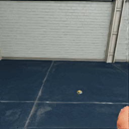
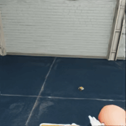

# VR Humanoid Behavior Lab

Control a **Unitree G1 with Inspire five-finger hands** in Isaac Sim using Quest Pro
controllers or optical hand tracking. The project records hand input, robot joints,
gaze, object states, and images for later analysis and learning experiments.

[](https://github.com/isaac-sim/IsaacSim)
[](tools/run_humanoid_tests.py)
[](LICENSE)

[Setup and controls](HUMANOID_VR_CONTROL.md) ·
[Recorded demos](#recorded-g1-demos) ·
[Developer guide and validation](docs/humanoid-control.md) ·
[Performance](docs/humanoid-control.md#performance-and-cpu-physics) ·
[Learning pipeline](learning/README.md)

| G1 bottle lift | G1 package lift |
|:---:|:---:|
|  |  |

Robot-camera screenshots from the **7 September 2026** G1 recording, at their native
256×256 resolution. Colored targets and gaze highlights are part of the recorded scene.

## Current behavior

The default is **stationary manipulation**. A world constraint anchors the robot's
pelvis while its arms and fingers remain controllable. Walking, turning, keyboard
locomotion, and step-in-place inputs cannot move the base in this mode.
The separate walking launcher uses **controller sticks for movement**, with
controller grips/triggers or optical hands for manipulation. The old gesture
launcher is an alias for it.

| Capability | Current implementation |
|---|---|
| Arm control | Valid optical wrist/middle-knuckle positions drive an anatomical palm target without a grip button or fist; controller grip holds enable arm movement, and release holds the arm pose. Measured contacts limit inward arm motion |
| Finger control | Five independent curl targets and separate thumb opposition from the optical skeleton; each controller index trigger proportionally closes that hand's fingers |
| Optional webcam | Quest remains primary for each arm and hand; calibrated webcam position, elbow guidance, and optional finger curls are used only for missing Quest input |
| Pickup | Experimental physical contact grasping with bounded finger targets; objects must be held by fingers and friction, with no hand-to-object fixed joint |
| Camera | Stabilized robot frame follows travel; HMD orientation rotates the view and its eye offset around the measured neck. Torso roll/pitch, gait bob, and real-world head translation are excluded |
| Gaze | Existing eye-tracking and highlighting behavior is retained; recordings label real eye input separately from HMD-forward fallback |
| Physics | CPU: 100 Hz stationary / 200 Hz walking; rendering requests 90 Hz stationary / 60 Hz walking |
| Recording | Enabled by default: sensor CSVs, metadata, and a PNG image sequence |
| Experimental walking | Left stick moves forward/backward/sideways; right stick turns. Grip/trigger manipulation and optical hands remain available; controller face buttons/stick clicks are unused, and blue pointing navigation is disabled but retained |

Inspire has six independent hand actuators. Distal knuckles are coupled, so it cannot
reproduce every human knuckle angle or finger-splay movement separately.

The latest source passed **888 offline tests**. Earlier controller replays passed all
six physical walking directions, release/loss/rearm checks, three Stop/Play cycles
and two Pause/Play cycles. The neck-anchored head and eye-arc camera passed 25 native
XR pose checks; ten desktop first-person views, including steep downward and
backward views, were clear with the final 5 cm near plane. These checks use
synthetic stick/head inputs where indicated; live tracking quality and perceived
comfort remain operator checks. Shelf pickup and loaded transport are separate tests.
See the [latest validation record](docs/validation/isaac-sim-6.1.md#controller-walking-and-visible-head--20-september-2026).

Residual walking checks now measure foot-centroid travel and mean sole heading,
allowing small stance corrections during reaching. After braking, a fault requires
matching root/support motion and more than 15 cm of support travel or 0.35 rad of
turning from a fixed reference. These are minimum excursions alongside speed/dwell
checks, not hard travel limits: slow or intermittent drift can evade this guard.
Fast-runaway and fall guards remain active. Earlier incident and backward/settle
passes predate this latest correction. The final source also passed a fresh physical
approach and carton press/withdrawal check without a fault.

During physical decoupled walking, measured upward contact forces on a hand also
limit inward arm motion into a graspable package. This helps avoid pushing a carton
down into a shelf while retaining side squeezing and withdrawal. It is a directional
motion limit, not force control or shelf-support detection; free or tilted cartons
can also trigger it. The native check verified blocked inward commands and clear
withdrawal; a complete real-hand lower-and-rotate placement remains unverified.

The latest object-reset investigation traced a carton snapping back to its authored
position to highlight binding changes. Shared highlights now use prebuilt visual
shells and change only shader inputs outside the simulated objects. They skip
writes when the visible color stays unchanged.
Gaze tracking and its ray are unchanged. A fresh physical test passed: setting and
clearing the highlight left a carton at its settled position, 20.30 cm away from
its authored pose, within 1.23e-7 m. Fresh rendered captures also confirmed the
original carton, green selection, and restored original appearance. The existing
pickup limitations still apply. Explicit Reset also avoids
initializing the robot twice and allows a repeated fault to be logged again.

**Windows VR renderer workaround:** the repository launchers now select Direct3D12
for this process with `--/app/vulkan=false`, leaving installed and global settings
unchanged. Native XR off/on crashed under Vulkan but passed twice under Direct3D12;
camera-pose and physical backward/settle checks also passed. This is a local workaround,
not a performance claim or a guarantee against every native crash. The user reported
**Stop → Humanoid Reset**, without requesting an XR restart. The registered Reset
handler and the existing built Reset button's callback passed under Direct3D12 with
XR enabled. The latter used `Button.call_clicked_fn()`, not a physical mouse click;
live hand/gaze quality remains an operator check. Restart Isaac through the repository launcher
to use the new renderer. See the
[renderer validation](docs/validation/isaac-sim-6.1.md#direct3d12-process-workaround).

A separate Clear/Load crash entered NVIDIA's Metrics Assembler change listener
during stage closure. The launcher now disables that edit listener while retaining
initial asset conversion. A fresh load and subsequent Clear/Load both passed with
the workaround, followed by successful XR startup. In-place asset variant/reference
changes require a fresh load. The separate Vulkan XR off/on failure is addressed by
the Direct3D12 workaround above. See the
[investigation record](docs/validation/isaac-sim-6.1.md#carton-reset-and-explicit-reset-investigation).

The **earlier pointing implementation** also passed a physical detour to an 8.53 m
destination around a packing table. Reliable close docking and tall-carton pickup
remained unvalidated. See the
[validation record](docs/validation/isaac-sim-6.1.md#comfort-camera-factory-routes-and-tall-cartons--20-september-2026)
for measured results, recording-pause improvements, and remaining limits. Those
earlier results do not validate shelf pickups or bimanual transport.

The first usable headset heading sets forward; keyboard **B** recenters that heading.
Calibration keeps the floor upright: startup pitch/roll are never saved as a
camera offset, while looking up/down and tilting your head remain tracked. Face your
intended forward direction and press **B** with Isaac focused after putting on the
headset if it was resting in a different direction at startup. The view uses the
G1's authored D435 optical-sensor height, about **4.6 cm above** the former head-bounds
midpoint. After settling, the neutral eye-height reference stays fixed for the level floor.
Robot travel and heading are smoothed; HMD rotation is applied without that filter.
The camera validates headset descriptors without adding an HMD filter. This installed
Kit uses its processed descriptor because the native raw-descriptor method is absent;
runtime smoothing and rendering latency still apply.
Turning your head rotates the camera's eye offset around the measured neck in the
stabilized robot frame, keeping the viewpoint outside the rotating head. Walking,
leaning, or crouching in the room does not translate the camera. The visible head rotates
with HMD orientation around a fixed neck pivot on the torso, so camera smoothing
cannot pull it away from the body. The camera keeps its existing robot-motion filter
and rejects gait bob and torso roll/pitch. Physical head colliders stay fixed because
G1 has no actuated neck.
Eye-gaze tracking is unchanged. This camera mode does not support ramps or stairs.

The current render-head helper keeps the head visible and attached at its measured
neck pivot in both camera modes. It does not translate the head to follow the
stabilized eye. Earlier camera-following and reversible hiding helpers remain for
legacy diagnostics. The fixed-eye camera contract is superseded: its downward view
looked inside the visible head. The orientation-driven eye arc is paired with a
baseline **5 cm near plane** in both the USD camera and native XR profile to clear
residual self-occlusion. Geometry within 5 cm of the eye is clipped, including a
hand or object brought that close. If measured head geometry intrudes during body
sway or camera lag, only the robot first-person near clip increases beyond those
bounds, with a 15 mm margin in 5 mm increments, returning toward 5 cm when clear.
It caps at 30 cm and reports larger intrusion; arbitrary falls are not covered.
Nearby hands/packages can temporarily clip. Camera/HMD/gaze matrices, head attachment
and visibility, external cameras and physics are unchanged. The prior XR setting is
restored on exit. Earlier fixed-5-cm checks passed 25 native poses and ten desktop
views; the adaptive change has not yet completed live visual acceptance.

| Restored visible head | Robot-eye shelf view |
|:---:|:---:|
|  |  |

Actual 20 September controller-profile renders. These show head visibility and
shelf layout, not a successful pickup. The open face is part of the loaded G1 mesh.


Earlier pointing scene from 20 September, looking down 30°. This static check shows camera
clearance and the raised handle; successful pickup remains unvalidated.

In the default stationary scene, the practice table is centered in front of the G1, with its top **0.92 m above
the floor**. Six lightweight objects sit in two rows 0.32 m and 0.44 m forward,
between the arms, with varied shapes, heights, and thicknesses:

| Color | Object | Dimensions | Mass |
|---|---|---|---:|
| Blue | Cube | 6 × 6 × 6 cm | 60 g |
| Orange | Cylinder | 6 cm diameter × 10 cm high | 80 g |
| Green | Sphere | 7 cm diameter | 50 g |
| Purple | Tall thin cylinder | 4 cm diameter × 14 cm high | 60 g |
| Yellow | Flat block | 9 × 6 × 3 cm | 70 g |
| Red | Cone | 7 cm diameter × 10 cm high | 50 g |

All use gravity and real collisions. The original cube and cylinder retain their
sizes and masses; earlier historical pickup results used smaller 4 cm objects.
Grasping the four new shapes has not been validated.
The sphere, cube, and orange cylinder now sit nearer the robot, with the other
three shapes in a second row. An earlier open-hand replay confirmed that both arms
can nearly straighten fully and retract without a fault. Reach still follows the
G1's actual geometry and joint limits; this layout change adds no arm length or
grasp guarantee. See [arm reach](HUMANOID_VR_CONTROL.md#palm-angle-arm-bending-and-latency).
Physical mode holds the arm pose on tracking loss or grip release.

**The reproduced sudden-stop case now passes.** Closing and opening the fingers
against the table previously caused unstable joint speeds and an automatic pause.
Adding a small joint-inertia floor to the hands passed all 20 close/open cycles,
with no fault or base movement and a clean withdrawal. A second test reconstructed
from recorded robot motion also passed. The guard remains enabled.

The enlarged cylinder passed a physical lift, hold, and release trial. **Cube pickup
remains unresolved:** both tested approaches failed to establish an opposing pinch,
although the robot remained stable. Earlier smaller-cube successes were also inconsistent.
Real headset handling remains unverified for this fix. See the
[validation record](docs/validation/isaac-sim-6.1.md).
The earlier fixed-joint assisted mode remains selectable for comparison; the recorded
demos below show that older assisted mode.
Each actuator retains its first-contact closing cap, with a **0.18 rad** lead,
preventing further closure from following a finger as it rolls over the contacted
body. A contact-report gap of up to **40 ms of simulation time** retains the command
cap only; support evidence clears immediately. Opening always wins; fully opening
the hand, input loss, and reset clear the retained caps.
Physical mode prepares finite, critically damped finger couplings before Play,
replacing the rigid settings that could destabilize the articulation at the table.
After arm smoothing, measured scenery-contact normals restrict motion into the
surface, including motion caused by wrist rotation. Withdrawal and sliding along
the surface remain available. Graspable props are excluded from this arm limit.
Loaded predictive contacts also limit arm motion before visible surface intersection.
The six actuators still drive the hand; passive knuckles receive no extra drives.
An invalid joint state pauses the simulation and requires **Reset or a scene reload**;
pressing Play alone cannot clear the fault. Gaze and hidden hand target spheres
are unchanged; head-view rotation is described above.

## Recorded G1 demos

These excerpts show **assisted pickup, lifting, and release** in a recorded stationary
G1 session. Click a preview to open its video file, or use the MP4 links below.

| Bottle pickup and transfer | Package pickup and release |
|:---:|:---:|
| [](docs/readme/g1-bottle-pickup.mp4) | [](docs/readme/g1-package-pickup.mp4) |
| [Open / download MP4 · 4.1 s](docs/readme/g1-bottle-pickup.mp4?raw=true) | [Open / download MP4 · 3.1 s](docs/readme/g1-package-pickup.mp4?raw=true) |

Videos are silent H.264 at 256×256 and 10 frames per simulated second. Playback follows
**simulation time**, not the slower wall-clock capture rate. These are visual examples;
they do not establish real Quest finger-tracking quality or camera-lock validation.
See [media provenance and export commands](HUMANOID_VR_CONTROL.md#screenshots-and-videos)
and the [validation results](#validation-and-known-limitations) for those distinctions.

## Quick start

The Windows launcher defaults to Isaac Sim **6.1.0** and loads the complete modified
`isaacsim.robot.policy.examples` extension directly from this checkout. The
[6.1 validation record](docs/validation/isaac-sim-6.1.md) covers software replay results
and the later live tracking recovery. A full
Isaac Sim source build is optional. For Quest Pro, keep the working OpenXR runtime and gaze setup;
the documented working connection uses SteamVR with Steam Link.

1. Clone this fork's teleoperation branch and fetch its Git LFS assets:

   ```powershell
   git clone --branch TeleopG1Sim https://github.com/soheilAppear/IsaacSim-HumanoidBehavior.git
   cd IsaacSim-HumanoidBehavior
   git lfs install
   git lfs pull
   ```

2. Extract Isaac Sim 6.1.0. The launcher uses
   `C:\Users\Soheil\Downloads\isaac-sim-standalone-6.1.0-windows-x86_64` by default.
   For another location, set `$env:ISAAC_DIR = "C:\path\to\isaac-sim"` in PowerShell.
   See [Installation](HUMANOID_VR_CONTROL.md#installation) for manual launch options.
3. Save any stage changes, close the previous Isaac session, connect the headset,
   and run:

   ```powershell
   .\tools\launch_isaac_vr.bat
   ```

   The launcher selects this checkout's complete policy extension, enables the Python
   server, and requests OpenXR skeletal hand tracking before the XR session starts.
   No copying into the standalone installation is needed.
4. Open **Window → Examples → Robotics Examples → Policy → Humanoid**
   (panel title **Humanoid: Unitree G1**), click **LOAD**, then **Play**.
5. Begin with the cube and cylinder on the near edge of the centered practice table.

See [Running](HUMANOID_VR_CONTROL.md#running) for the detailed startup procedure.
After changing Python source, restart Isaac Sim and reload the example so it uses
the updated classes.

### Optional webcam alongside Quest

The webcam tracker runs in its own Python environment. It sends landmarks over
localhost; it does not install ML packages into Isaac. Enable it explicitly and
calibrate with both hands visible to Quest and the webcam before using fallback.
See [webcam setup and calibration](HUMANOID_VR_CONTROL.md#webcam-alongside-quest)
for commands and tracking-loss behavior. This is an experimental single-camera
input, not full-body locomotion or reliable tracking through occlusion.

### Controller walking and optical manipulation

Close the previous Isaac session, keep SteamVR running, and launch:

```powershell
Set-Location 'C:\Users\Soheil\Documents\GitHub\IsaacSim-HumanoidBehavior'
.\tools\launch_controller_walking.bat
```

LOAD the Humanoid example and press **Play**. `launch_gesture_walking.bat` now
launches this same controller profile for compatibility. The base
`launch_isaac_vr.bat` remains the stationary option.

| Input | Controller walking profile |
|---|---|
| Center both sticks | Enable walking input after startup, Stop/Pause/Reset, controller loss, or an input interruption |
| Left stick forward/backward | Request forward/reverse walking |
| Left stick left/right | Request sideways walking |
| Right stick left/right | Request turning |
| Release sticks or lose a valid controller | Clear walking commands; the physical robot must still brake |
| Optical wrist/palm and finger motion | Control the corresponding robot arm and individual fingers |
| Each controller side grip | Hold to move/rotate that arm; release holds its current pose |
| Each index trigger | Squeeze proportionally to close that hand; release to open, independently of the grip |
| Controller A/B/X/Y and stick clicks | Unused in this walking profile; keyboard B recenters the view |

Stick deflection controls requested speed continuously after a **15% deadzone**.
Full deflection requests up to **0.65 m/s forward, 0.35 m/s reverse, 0.30 m/s sideways
or 0.40 rad/s turning**; half the usable travel requests half that speed. Diagonal
translation is capped. Centering stops requests immediately; the physical robot
still needs to brake. These are command caps, not guaranteed achieved speeds.

The blue ray and pointing selector are disabled; their implementation is retained.
Gaze and its red ray are unchanged. Keyboard **B** still recenters the view.
This profile also temporarily disables Kit's built-in VR navigation and object
manipulation tools so the same sticks/triggers cannot move the native viewer or
scene objects. Raw headset, eye, hand and controller input remains enabled; the
previous tools layout is restored on XR/profile exit or example cleanup.
The same pretrained GR00T WholeBodyControl actor and physical safeguards remain.
All six walking directions passed physical replays with synthetic stick input.
Pickup and loaded transport require separate validation.

**The current Quest/SteamVR setup switches between controllers and optical hands.**
It does not presently supply both simultaneously. With controllers active, grip moves
an arm and trigger closes its fingers. You can release grip to hold the arm pose while
keeping trigger squeezed and using the sticks. When switching to bare hands, valid
optical poses and individual fingers take over; stale stick values are cleared.
Returning to controllers requires centered sticks before movement resumes. Controller
trigger closure is not measured finger tracking. Calibrated webcam input remains an
optional fallback when primary input is unavailable. To deliberately retain the former
optical-only manipulation profile, set `G1_OPTICAL_HANDS_ONLY=1` before launching;
otherwise the launcher defaults it to `0` without replacing an explicit override.

Controller walking adds model-based gravity holding torque to the fourteen arm
joints, within their existing motor limits. It supports the robot's own arm weight;
it does not estimate payload weight or grip pressure. This addition is off in the
stationary and retained pointing profiles. The shared seven-joint arm solver also
uses remaining joints to align the palm when a wrist reaches its limit, while
preserving the primary reach. Joint/contact limits still apply, and these changes
do not establish successful shelf pickup or loaded walking.

The controller scene adds **12 handle-free cartons on three two-level shelves**,
retaining the six table objects and four floor cartons (**22 movable props**).
The racks are **1.60 m wide** with shelf heights from **0.68 to 1.06 m**;
cartons are **0.10–0.25 kg**, with different widths and heights. These represent
light empty cartons, not loaded warehouse packages. To attempt a two-hand wrap,
stop, place the palms
on opposite box sides, curl the fingers around it, and lift gently. Objects use
real contacts and friction, without attachment joints or adhesive forces.
The new bimanual diagnostic recognizes opposing contacts across both hands and
reports measured normal force plus estimated friction capacity. Its status does
not prove a successful lift, pressure measurement, or stable carried load.
The latest synthetic replay completed a contact-free approach but failed to hold
the carton. The revised palm-first validator now checks opposing palm contact
before curling and opposing side contact before lift. Its live grip-only trial
failed the palm-contact gate and stopped before curling or lifting.
See the [validation record](docs/validation/isaac-sim-6.1.md#shelf-pickup-attempts-remain-failed).

### Retained pointing navigation

**Walking is opt-in; the normal launcher remains stationary.** The pretrained
NVlabs GR00T-WholeBodyControl G1 balance/walk models command 15 leg/waist joints
while both arms and fingers retain teleoperation. These are upstream models;
this repository does not train them. This is GR00T **Whole-Body Control**, rather
than the GR00T foundation/VLA model. The following describes the retained
**left-hand pointing** profile, which is disabled in both walking launchers.
To select it explicitly for development, close Isaac and run:

```powershell
Set-Location 'C:\Users\Soheil\Documents\GitHub\IsaacSim-HumanoidBehavior'
$env:G1_GESTURE_WALKING = '1'
$env:G1_LOCOMOTION_INPUT = 'pointing'
$env:G1_POINTING_NAVIGATION = '1'
.\tools\launch_isaac_vr.bat
```

LOAD the Humanoid example and press **Play**:

1. Open your left hand first. This is required again after Stop, Pause, or Reset.
2. Point with the left **index finger straight**, with middle, ring, and little
   fingers curled. Thumb position is ignored. A **blue ray** shows your pointing.
3. Hold the blue ray steadily on a clear floor spot or practice object for **0.6 seconds**. The marker
   turns cyan during acquisition, then green when the destination is locked.
4. Keep pointing to walk toward the locked destination. Open your left hand to stop.
   Your gaze can face anywhere during selection and walking; its existing red ray
   continues to work independently.

Cruise requests now reach **0.65 m/s** (previously 0.45 m/s). Slowing begins
within **1.60 m** of the target; the final approach and 30 cm arrival threshold
retain their previous behavior. Actual speed depends on the learned controller
and simulation throughput. The 19 September physical replay passed forward walking,
both turns, and stopping. It averaged **0.488 m/s in simulation** on the straight
phase; measured world-forward progress per wall second was about **2.29×** the
earlier 0.45 m/s run. A synthetic 3 m destination replay, reaching at 0.65 m/s,
and VR Stop/Play checks also passed. Operator pointing accuracy remains unverified.

Choose a visible floor spot **0.5–50 m** away, in any direction around the robot.
An adaptive angular filter reduces pointing jitter; drawing and collision queries
use the same filtered ray. Dwell allows **18–30 cm** of drift according to distance,
measured from the first hit throughout the 0.6-second hold. A ray miss hides the
hit marker. The ray stops at its first object. A practice-object hit can select a separately
checked floor approach point; walls and tables block selection. No floor hit is invented.
The direct route must clear a **0.76 m-wide corridor**, including body clearance
and a 10 cm braking reserve inside the 30 cm arrival radius. When that route is
blocked, the robot stands still while a bounded planner checks a detour through
the factory. Keep pointing during planning; opening the hand cancels it.
Large heading changes request **0.4 rad/s stepping turns** from the physical actor,
with zero requested forward travel; the body can drift as its feet step. Curved
forward steering remains capped at **0.2 rad/s**. Fresh body and route checks use
the measured position throughout both kinds of turn. A turn stops if heading fails
to improve by **0.05 rad within 15 wall seconds**; open the hand before retrying.
A synthetic 180° turn-and-approach replay passed; the stepping phase drifted
**0.493 m**, so this is not a fixed-position pivot.
For an object target,
the blue hit stays on the object and the floor marker shows where the robot stops.
The robot requests a stop within **0.30 m** of its destination, on invalid hand
tracking, or if its route becomes blocked. Release the pointing gesture before
selecting again. There is no reverse or strafe command. The blue collision ray
extends 60 m; targets beyond the 50 m walking limit remain ineligible. Controller
or webcam input cannot authorize walking. Eye tracking is not a walking input;
its availability, direction, and fallback do not gate destination selection.

Starts use bounded wall-time smoothing, so a slow simulation no longer stretches
the command ramp in proportion to its slowdown. The physical gait still advances
at the simulation's speed. `gesture_locomotion_status()` reports the selection
state, target, acquisition progress, input `detail`, requested/filtered velocities,
and policy mode. Stop invalidates physics caches; Play requires fresh navigation
input. Camera scheduling waits for ready XR and valid finite poses, preserving
the mounted-camera mapping. **Three Stop/Play and two Pause/Play cycles passed
with real XR active and no fault.** The reported restart crash did not recur in
those checks, which predate the point-only change. The full point-only physical
replay passed with synthetic pointing; actual Quest pointing accuracy and occlusion
remain operator checks. The diagnostic mode is `point_only`.

Tracking-loss stopping requires current tracked landmarks, rather than merely
valid inferred poses. A cached skeleton still incorrectly marked tracked by the
XR runtime can conceal occlusion, so real Quest tests of
hands leaving the camera view are still required; immediate stopping in that case
is not established by synthetic loss tests.

This scene moves the practice table to `(2, -2)` m and adds four physical warehouse
cartons beside the walking aisle. It uses gravity and pretrained leg/waist actors,
with no root teleporting or kinematic fallback. Three additional lightweight,
tall cartons have handles at **0.680, 0.800, and 0.935 m** above the floor after
settling (authored heights **0.685, 0.805, and 0.940 m**).
Their stations are `(3.5, 2.8)`, `(3.5, -2.8)`, and `(1.35, 0)` m.
The tallest carton is directly ahead of the starting robot for an initial pickup
attempt; it is a physical obstacle, so longer routes must go around it.
Stop, reach an open hand around a handle, oppose the thumb, then close and lift;
opening releases it. These props use contact and friction, with no grasp attachment.
It retains G1's learned controller; the H1 sample's network is not transplanted
onto this different robot. Planning is bounded: narrow aisles, missing floor,
blocked turning space, or the search limit can still reject a destination.
Planned detours reserve approximately **0.687–0.910 m half-width**, depending on
route angle, to contain the full runtime turning square plus 0.15 m of tracking
error. Their start and actual corners require about
**1.037 m half-width**, including 0.50 m for observed stepping drift. Straight
sections do not all require that larger corner space. Direct close-object
approaches retain their previous braking-aware clearance. The first physical
detours stopped safely beside a table. The corrected projected planner passed a
physical detour to a destination 8.53 m away around that table, stopping 0.299 m
from its target. This does not establish access to every factory aisle or transport
while carrying a package.
**Stop before precision pickup:**
the tested extended right palm remained about 9–10 cm from its target while walking
and stopped. The new tall-carton pickup, floor pickup, crouching, and payload
carrying are not established by earlier replays. Gaze
and the external webcam fallback pipeline are unchanged. See the
[walking controls and current limits](HUMANOID_VR_CONTROL.md#controller-walking-and-optical-manipulation)
and [policy provenance](source/extensions/isaacsim.robot.policy.examples/isaacsim/robot/policy/examples/robots/data/README.md).

Walking mode applies the pretrained controller's outward-arm shoulder-roll limits,
including while balancing at zero command. Arm tracking remains
live within those limits; stationary-mode reach is unchanged. These limits were
enabled during the latest physical destination and stopping checks. Arbitrary
simultaneous reaching and walking remains unvalidated.

## Controls

These arm and pickup controls apply to the default **stationary** scene. The
separate walking demo keeps legs and waist under policy control and accepts arm
and finger input within the walking limits described above.
In the controller walking profile, grip/trigger manipulation and optical hands remain
available. Face-button and stick-click actions in this stationary table are disabled;
use keyboard B for heading recentering while walking.

| Input | Action |
|---|---|
| Hold left/right **grip** | Move and rotate that arm; grip alone leaves the fingers open |
| **Trigger** | Close that hand around the object; physical pickup depends on contact and friction |
| Release **grip** | Hold that arm's pose in physical mode; valid trigger input still controls the fingers |
| Controller **Y** | Force both hands open; release the trigger or open your tracked fingers to rearm |
| **B** | Recenter forward heading; preserve physical pitch/roll and a level floor reference |
| Turn / tilt the headset | Rotate the view while its position stays mounted to the robot |
| Left stick click | Retain the mounted camera mode |
| Sticks, X/A, locomotion keys, head movement | No base movement in stationary mode |
| Open optical hand | Valid wrist/middle-knuckle positions activate the arm without a fist; fingers update independently from valid digit landmarks |
| Bend an optical finger | Move the corresponding robot finger |
| Close/open optical hand | Pinch or wrap around the object with thumb opposition; open to release |

Y is ignored while using bare-hand tracking. If switching from a controller after
a drop, open all four tracked fingers once; the thumb can remain naturally relaxed.

For controller pickup, **hold grip**, reach with the trigger released, then pull the
trigger when the actual robot fingers are close to the object. Keep grip and trigger
held to carry; release the trigger to open. A highlight does not attach an object.
Use optical thumb opposition and a pinch or wrap that actually encloses the object;
for the cube, bring the thumb pad across to face the index pad on opposite sides.
Making a fist nearby is insufficient. See the [full control guide](HUMANOID_VR_CONTROL.md#controls)
for input mapping, tracking loss, and release behavior.

If optical arm tracking disappears without a calibrated webcam alternative,
physical mode holds the measured arm pose until tracking returns. Missing finger
input still opens the fingers. This prevents an automatic return to rest from
dragging a hand through the table.

## Validation and known limitations

Point-only walking is experimental. **504 offline checks passed in 9.017 seconds**.
The full physical replay passed all five phases: destination approach, arrival
stopping, hand release, explicit tracking loss, and final balance. It advanced
**0.6047 m**, stopping the approach **0.29987 m** from the target, without a health
fault or callback error. Only navigation hand measurements were synthetic; real
scene queries, blue visuals, and the pretrained controller remained active. The
hand reader was restored, gaze was untouched, and the timeline was paused afterward.
The updated point-only mode also passed **three Stop/Play and two Pause/Play**
cycles without faults, requiring a fresh hand release. XR was disabled and no
devices were connected in that lifecycle run, so it validates desktop physics
restart only. Point-only Quest hardware, pointing accuracy, and occlusion behavior
remain operator checks.

**Historical point-and-gaze validation:** **505 offline checks passed.**
That synthetic-input physical replay moved **0.603 m**, reached **0.29985 m**
from its selected target, and passed arrival stopping, hand release, and explicit
tracking-loss checks. Its 300-second wall-time budget expired during the final
balance hold. A separate **3.01 simulation-second** continuation passed with final
planar speed about **0.0001 m/s** and no health fault. This is a set of passing
phases and a separate continuation, not a complete uninterrupted replay pass.
Input overrides were restored and the gaze tracker was preserved.

**Earlier V-controller-era**
real PhysX tests passed zero-command
balance, forward walking, left/right forward steering, and stopping without root
anchors. A separate replay passed right-arm reaching, finger closure/reopening,
stopping with the arm extended, and synthetic tracking loss. Extended-palm error
was about 9–10 cm, so stop before precision pickup and treat accuracy as unfinished.
These historical replays do not validate the new destination selector. Separate
real-XR checks passed three Stop/Play and two Pause/Play cycles without faults.
Actual operator pointing/occlusion acceptance, floor pickup, and payload carrying remain
unvalidated. Check the [validation record](docs/validation/isaac-sim-6.1.md) for the
measured configuration and reproducible live-test command.

The **17 September Quest-priority update** passed **329 offline tests**, fresh-scene
and reset checks, and a synthetic PhysX replay covering both object rows and lowered
hands while webcam input was unavailable. The centered table measures **0.92 m**
high. A corrected startup pose prevents the hands from striking props before
control initializes. See the
[current validation record](docs/validation/isaac-sim-6.1.md#quest-priority-and-table-reach--17-september-2026).

The earlier **16 September** checks also verified real webcam-to-Isaac packets.
Real headset-plus-webcam calibration, field-of-view handover, and detailed camera
finger detection still need an operator check. A headless scene reload crashed in
Isaac's native debug-draw plugin during that work; subsequent replays used a fresh
process. See the [webcam validation record](docs/validation/isaac-sim-6.1.md#optional-webcam-integration--16-september-2026).

Historical checks on **7 September 2026**, using Isaac Sim **6.0.0**:

| Check | Result and scope |
|---|---|
| Offline regressions | **82 passed**, including open-hand acquisition without buttons, independent fingers, grip/pickup, camera, lifecycle, and gaze regressions |
| Live grip and pickup replay | Passed with real PhysX: attached, lifted, and released a package; stationary base unchanged |
| Live finger replay | All ten fingers and both thumb-opposition joints moved independently; controller fallback and tracking-loss checks passed |
| Live camera replay | Fixed camera-to-body mount held during Play and Pause; tested with the Quest session connected |
| Real eye input | `eye_tracker` was observed with zero failed updates during the connected checks; gaze implementation/settings were preserved |
| Real Quest finger input | Skeletons arrived intermittently in this historical check; see the 12 September recovery below |

These camera results concern the former fully fixed view. The current orientation-driven
eye arc has separate checks; they do not retroactively validate its headset behavior.

The live replays inject input at the XR boundary and measure real simulation behavior.
They establish control and physics behavior; they do not establish headset tracking
quality. Generic grip/aim/pinch/poke interaction poses are insufficient for
individual fingers. A detected controller model also does not establish that a real
hand skeleton is reaching Isaac. See [Troubleshooting](HUMANOID_VR_CONTROL.md#troubleshooting).

The **11 September 2026 / Isaac Sim 6.1.0** checks passed NVIDIA's hardware checker,
all **83 offline tests**, actual PhysX pickup/release, camera mounting during Play
and Pause, and a full finger replay in an initialized fresh scene. A finger replay
run immediately after pickup failed on the right little finger; its cause remains
unresolved. The fresh-scene pass does not establish that all checks pass in every
manipulation state.

During a separate 60-second real-input observation, the connected headset used
Oculus/Meta transport through SteamVR and supplied **zero optical hand samples**;
unified eye gaze was unavailable. Gaze code and settings were preserved. On **12
September**, the user confirmed that starting SteamVR independently restored both.
The subsequent recording contains 1,627 optical-hand samples per side and 1,627
measured-eye samples during its last uninterrupted minute.
See the [6.1 validation record](docs/validation/isaac-sim-6.1.md) for measurements,
the corrected package colliders, and exact reproduction steps.

The current update includes anatomical palm alignment, stable palm-centre targets,
bounded IK task priorities, wall-time input filtering, and an experimental physical
grasp mode. The user accepted the arm changes. The table-contact repair combines
finite compliant finger couplings, limits on inward arm commands, and a joint-health
guard. Three consecutive fixed-pose table-contact replays passed, but the later
dynamic close/open stress test exposed a further fault. The selected hand-joint
inertia floor passed that same 20-cycle test. Larger objects and motion derived from
the recorded failure were checked separately: the derived path and larger-cylinder
pickup passed; both larger-cube grasp trials failed without destabilizing the robot. See
[palm angle, arm bending, and latency](HUMANOID_VR_CONTROL.md#palm-angle-arm-bending-and-latency).

The **12 September head/reach update** passed **242 offline tests**, including head-turn direction, release-latch recovery, retained contact caps,
arm-contact limits, articulation health, and hand-joint stabilization. See the
[validation record](docs/validation/isaac-sim-6.1.md) for configurations and results.
Historical starter-object passes apply only to their recorded settings; no replay
establishes arbitrary-object pickup or headset tracking accuracy.
The earlier fresh-scene combined pickup replay failed because the smaller cube
slipped with the exploratory grasp profile; it does not validate the enlarged objects.

At the stop-fix handoff, a fresh production scene was paused with live input restored,
hidden hand markers, and no physics fault or callback error. Isaac reported no XR
devices, so these checks do not establish real Quest handling. The ready-state record
is `_compat61/stop-fix-ready-state.json`; see the
[validation record](docs/validation/isaac-sim-6.1.md) for its timestamp and configuration.
That snapshot predates the four additional practice shapes.

Run offline tests with Isaac Sim's Python wrapper:

```powershell
& "C:/path/to/isaac-sim-standalone-6.1.0-windows-x86_64/python.bat" tools/run_humanoid_tests.py
```

With the updated example loaded and the Python server enabled, run live checks
**one at a time** using ordinary host Python. The older
`tools/validate_camera_live.py` checks the historical rigid mount; use the
[current camera acceptance procedure](docs/humanoid-control.md#camera-and-finger-validation)
for the stabilized view.

For a fresh, initialized physical-mode scene, check light contact with the table:

```powershell
python tools/validate_table_contact_live.py --timeout 240
```

This synthetic right-hand replay approaches an empty table area, commands a small
downward motion, holds, then withdraws. It records contacts, joint state, and root
stability in `_compat61/table-contact-live.json` and leaves live input restored with
the timeline paused. Its report determines whether that run passed.

In a fresh physical-mode scene with the original cube and cylinder on the front table, recheck
the synthetic palm-down grasps after changes to hand physics. The replay selects
an object-specific thumb pose and approach:

```powershell
python tools/validate_contact_grasp_live.py --object both --timeout 300
```

It records contact/lift/hold/release results in `_compat61/contact-grasp-live.json`,
restores input, and leaves the scene paused. Open your input before resuming after
its forced-drop cleanup. This trial uses real PhysX with synthetic optical landmarks;
its report states whether that run passed. It does not validate headset tracking.
`--object both` exercises the original cube and cylinder only; it does not test the
sphere, tall cylinder, flat block, or cone.
When a recording session exists, `validation_<run_id>.json` marks this synthetic
interval by time and physics step; other samples in the session may be real user input.

Before a full finger replay, restart Isaac Sim, LOAD a fresh example, press Play,
and wait for initialized finger joints. Then run:

```powershell
python tools/validate_fingers_live.py --timeout 420
```

These replays restore live input and leave the timeline paused. To observe real
hands, press Play, switch the headset to bare hands, and bend individual fingers:

```powershell
python tools/observe_hand_tracking_live.py --seconds 20
```

The observer changes no input, timeline, or gaze settings. Commands for the separate
legacy assisted pickup/highlight replay, which temporarily substitutes gaze input, and detailed
results are in [Automated validation](docs/humanoid-control.md#automated-validation).

## Performance

**Stationary mode requests 100 Hz CPU physics and 90 Hz rendering; gesture walking
requests 200 Hz physics and 60 Hz rendering. These are configured rates, not measured performance
guarantees.** The last active minute of the 12 September recording advanced 16.26
simulated seconds in 59.992 wall seconds: **0.271× real time**, or roughly 3.7 times
slower. This is a baseline from before the arm-response changes.

The first 19 September update removed repeated hand calculations and hidden-marker USD
writes, and uses Fabric to pass CPU physics poses to the renderer. In short live
windows with Quest optical hands and recording enabled, application updates rose
from **19.08 to 23.37/second**, and real-time factor from **0.212 to 0.259**.
These are application measurements, not headset FPS or end-to-end hand latency;
the simulation remains below real time. Gaze, camera mapping, physical timestep,
and contact limits remain unchanged.

The subsequent pointing update batches hand reads, bounds raw arm IK to 100 Hz
while retaining 200 Hz feedback, removes duplicate body PD work, and uses faster
lossless PNG compression. Walking rendering is now configured at 60 Hz on startup.
Comparable short observations advanced from **0.255 to 0.364 simulation seconds
per wall second** (about **42% more progress**), while application updates changed
from **23.00 to 21.77/second**. Simulation remains below real time; these are not
headset-FPS or motion-to-photon measurements. **568 offline tests passed**. The
0.65 m/s baseline and reaching replays passed without faults. A synthetic 3 m
destination replay passed approach, arrival, release, loss, and final balance;
three Stop/Play and two Pause/Play cycles passed with XR active. These checks do
not establish operator pointing accuracy or perceived jitter.

Rendering uses the GPU; physics and the small walking actor remain on CPU.
Forcing 100% utilization is not a latency target. The
[performance guide](docs/humanoid-control.md#performance-and-cpu-physics) explains
measurements, tradeoffs, recording overhead, and remaining limits.

## Data and learning

Sessions are written under `~/BehavioralCollection/raw_sessions/` with sensor CSVs,
`metadata.json`, frame timestamps, and eye-camera PNGs. Rates are defined in simulation
time; behavior, hand, gaze, and object rows remain nominally **100 Hz in both modes**.
Recording intervals adjust to the physics timestep, so 200 Hz walking physics does
not double those log rates. Gaze queries remain 50 Hz and their latest result is reused.
Periodic CSV flushes use one background writer with up to eight pending batches;
disk I/O no longer runs in the physics callback. Orderly cleanup drains accepted
writes, but an interrupted process can still lose queued or unflushed rows.

Gaze hits record the collider intersected by the supplied ray; they are observations
of the gaze signal, not a guarantee of human intent. Grasp mode must accompany each
recording; old fixed-joint demonstrations are assisted grasping, not physical contact
successes. See [Behavioral data collection](HUMANOID_VR_CONTROL.md#behavioral-data-collection)
for files and columns.

The [learning directory](learning/README.md) contains the planned dataset and
world-model workflow. A trained planner is not integrated into the current robot
controller. Optional webcam arm and finger fallback is implemented; Quest remains
the primary source. After live calibration and contact grasping pass operator
checks, the [next research phase](HUMANOID_VR_CONTROL.md#next-research-phase) can
investigate gaze and hand/finger velocity as intent cues. Velocity is not measured
finger pressure. A new intent-training pipeline is not implemented yet.

## Project layout

| Path | Purpose |
|---|---|
| [interactive/humanoid/](source/extensions/isaacsim.robot.policy.examples/isaacsim/robot/policy/examples/interactive/humanoid/) | Scene, input, IK, pickup, camera, gaze, and recording |
| [robots/g1.py](source/extensions/isaacsim.robot.policy.examples/isaacsim/robot/policy/examples/robots/g1.py) | Stationary anchor, joint control, optional locomotion, and reset |
| [tools/](tools/) | VR launcher, live Python helper, observers, and validation replays |
| [tools/tests/](tools/tests/) | Offline control regression suite |
| [HUMANOID_VR_CONTROL.md](HUMANOID_VR_CONTROL.md) | Installation, operation, recording, and troubleshooting |
| [docs/humanoid-control.md](docs/humanoid-control.md) | Implementation details, performance, and validation evidence |
| [learning/](learning/) | Learning workflow plan and directory scaffolding |

## Earlier captures


This clip was recorded with the earlier H1 robot. It illustrates gaze highlighting
and recording; the current G1's stationary behavior and finger validation are
described above.

## Isaac Sim source and licensing

This fork includes the Isaac Sim source tree. For full simulator development, see
the [upstream Isaac Sim repository](https://github.com/isaac-sim/IsaacSim),
[Windows developer setup](docs/readme/windows_developer_configuration.md), and
[container build guide](tools/docker/README.md). `build.bat --help` or
`./build.sh --help` lists this checkout's source-build options.

Repository licensing is described in [LICENSE](LICENSE). Bundled policies and assets
retain their own notices; see the [setup guide's license references](HUMANOID_VR_CONTROL.md#license).
Fork-specific issues belong in [this repository's issue tracker](https://github.com/soheilAppear/IsaacSim-HumanoidBehavior/issues).
